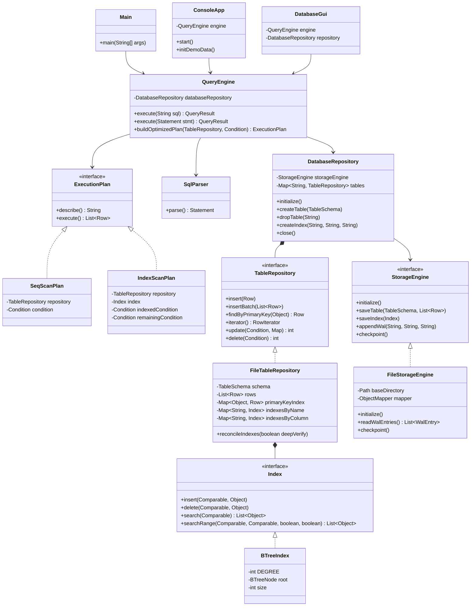
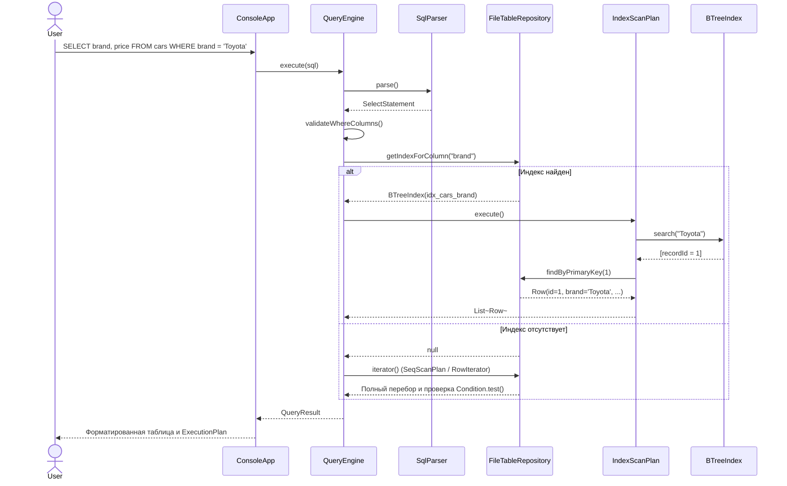
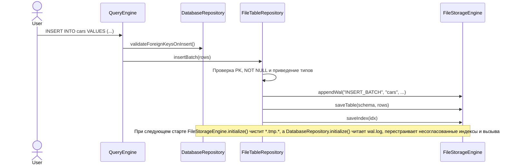

# Упрощенная реляционная СУБД на Java (Simple DBMS)

Проект для лабораторной работы 2 по разработке упрощенной реляционной СУБД на Java 17. Движок сохраняет таблицы и индексы в JSON на диске, ведет журнал `wal.log` для восстановления после сбоев, разбирает SQL-запросы и работает как из консоли, так и через окно на Swing.

## Содержание

1. [Возможности системы](#1-возможности-системы)
2. [Архитектура системы](#2-архитектура-системы)
3. [Инструкция пользователя](#3-инструкция-пользователя)
4. [Результаты тестирования производительности](#4-результаты-тестирования-производительности)
5. [Команда и распределение файлов для нового репозитория](#5-команда-и-распределение-файлов-для-нового-репозитория)
6. [Выводы](#6-выводы)
7. [Список использованных источников](#7-список-использованных-источников)

## 1. Возможности системы

Столбцы таблиц поддерживают пять типов: `INT` (внутри `Long`), `DOUBLE` (`Double`), `VARCHAR` (`String`), `DATE` (ISO-8601 `YYYY-MM-DD`, `LocalDate`) и `BOOLEAN` (`Boolean`). При создании таблицы на столбец можно повесить ограничения `PRIMARY KEY`, `NOT NULL` и внешний ключ `REFERENCES <table>(<column>)`.

Движок проверяет уникальность и непустоту первичного ключа при одиночной вставке, пакетном `INSERT` и `UPDATE`. Связи внешних ключей проверяются перед `INSERT`, `UPDATE`, `DELETE` и `DROP TABLE`: нельзя вставить дочернюю строку со ссылкой на несуществующего родителя, а родительскую строку или таблицу нельзя удалить либо изменить в ключевом поле, пока на нее ссылаются записи из дочерней таблицы.

Таблицы, схемы и индексы сериализуются через Jackson в каталог `data/`: файлы схем и строк лежат в `data/tables/*.schema.json` и `data/tables/*.data.json`, индексы вынесены в `data/indexes/*.idx.json`. Запись идет через временный файл `*.tmp.*` с последующим атомарным перемещением поверх старого файла.

Перед изменением структуры или данных операции пишутся в `data/wal/wal.log`. Если прошлый запуск завершился аварийно и `wal.log` не был очищен вызовом `checkpoint()`, при старте `FileStorageEngine.initialize()` удаляет недописанные `*.tmp.*` файлы, а `DatabaseRepository.initialize()` считывает журнал (игнорируя оборванную последнюю строку), сверяет каждый индекс с фактическими строками таблицы и при расхождении перестраивает его заново, после чего очищает `wal.log`.

В парсере реализованы:
- создание и удаление таблиц `CREATE TABLE [IF NOT EXISTS]` и `DROP TABLE [IF EXISTS]`, включая типы с длиной вроде `VARCHAR(100)` или `DECIMAL(10, 2)`;
- управление индексами через `CREATE INDEX [IF NOT EXISTS] ... ON ...` и `DROP INDEX [IF EXISTS]`;
- вставка `INSERT INTO` с полным списком значений, явным перечнем столбцов или несколькими кортежами через запятую;
- выборка `SELECT` (`*` или перечисленные колонки), изменение `UPDATE ... SET ... WHERE` и удаление `DELETE FROM ... WHERE`;
- фильтр `WHERE` с операторами `=`, `!=`, `<>`, `>`, `>=`, `<`, `<=`, `IS NULL`, `IS NOT NULL`, логическими связками `AND` (приоритет выше) и `OR`, скобками `(...)` и комментариями `--`;
- служебные команды `SHOW TABLES`, `SHOW INDEXES [FROM|IN <table>]`, `DESCRIBE <table>` (или `DESC <table>`) и `EXPLAIN <SELECT ...>`.

Для индексов написано сбалансированное B-дерево (`BTreeIndex`) с минимальной степенью `t = 8` (до 15 ключей и 16 потомков в узле). Повторяющиеся ключи хранят список идентификаторов строк. При поиске по точному совпадению вызывается `search`, при сравнениях `>`, `>=`, `<`, `<=` используется `searchRange`, а удаление узлов выполняется с заимствованием ключей у соседей и слиянием. Если в `WHERE` (в одиночном условии или в одном из конъюнктов `AND`) есть условие по проиндексированному столбцу, кроме `IS NULL` и `!=`, планировщик строит `IndexScanPlan`, иначе идет последовательно через `SeqScanPlan` и `RowIterator`.

## 2. Архитектура системы

Пакеты внутри `ru.danis.dbms` разделены по слоям. В `model` описаны типы столбцов (`DataType`), сами столбцы и внешние ключи (`Column`, `ForeignKey`), схема таблицы (`TableSchema`), строка (`Row`) и результат запроса (`QueryResult`). Слой `storage` (`StorageEngine`, `FileStorageEngine`, `WalEntry`, `RowIterator`) отвечает за чтение и атомарную запись JSON на диск, ведение `wal.log` и последовательный обход записей. В `index` лежат интерфейс `Index` и B-дерево `BTreeIndex`.

За целостность таблиц и связей отвечает пакет `repository` (`TableRepository`, `FileTableRepository`, `DatabaseRepository`). Разбор SQL собран в `parser` и `parser.statement`: там находятся лексер `SqlLexer`, токены, рекурсивный парсер `SqlParser`, дерево условий `Condition` и классы команд `Statement`. В `engine` планировщик `QueryEngine` выбирает между `IndexScanPlan` и `SeqScanPlan` (интерфейс `ExecutionPlan`). Над движком работают консоль (`cli.ConsoleApp`, `cli.TablePrinter`), окно Swing (`gui.DatabaseGui`), замер скорости (`benchmark.BenchmarkRunner`) и точка входа `Main`.

### Диаграмма классов



### Диаграмма последовательности: выполнение `SELECT` с индексом и без индекса



### Диаграмма последовательности: вставка записи, WAL и восстановление



## 3. Инструкция пользователя

### Требования и сборка

Нужны JDK 17+ и Apache Maven 3.8+.

Сборка проекта с прогоном всех 49 модульных тестов и упаковкой зависимостей в один JAR:

```bash
mvn clean package
```

Сборка Javadoc (проверяется со строгим `-Ddoclint=all` без предупреждений):

```bash
mvn javadoc:javadoc
```

### Запуск программы

По умолчанию файлы базы сохраняются в `./data`:

```bash
java -jar target/simple-dbms-1.0.0.jar
```

Можно передать каталог данных и режим работы через флаги:

```bash
# Свой каталог для файлов базы
java -jar target/simple-dbms-1.0.0.jar --data ./my_data

# Графический интерфейс на Swing
java -jar target/simple-dbms-1.0.0.jar --gui

# Быстрое создание таблиц manufacturers и cars без запуска REPL
java -jar target/simple-dbms-1.0.0.jar --init-demo

# Замер скорости SeqScan и IndexScan
java -jar target/simple-dbms-1.0.0.jar --benchmark
```

### Консольные команды и примеры SQL

В консоли доступны короткие команды (точку с запятой после них можно опустить): `help` печатает памятку по SQL и командам, `init-demo` создает таблицы `manufacturers` и `cars` со связью по внешнему ключу и индексом (повторный вызов безопасен), `tables` выводит список таблиц, `indexes` показывает все индексы, `schema <таблица>` выводит столбцы и ограничения таблицы, `benchmark` запускает тест скорости, а `exit` или `quit` сбрасывает контрольную точку WAL и закрывает программу.

Обычные SQL-команды заканчиваются точкой с запятой `;` и могут переноситься на несколько строк:

```sql
CREATE TABLE manufacturers (
    id INT PRIMARY KEY,
    name VARCHAR(100) NOT NULL,
    country VARCHAR
);

CREATE TABLE cars (
    id INT PRIMARY KEY,
    brand VARCHAR NOT NULL,
    price DOUBLE,
    is_available BOOLEAN,
    created_at DATE,
    manufacturer_id INT REFERENCES manufacturers(id)
);

CREATE INDEX idx_cars_brand ON cars (brand);

INSERT INTO manufacturers VALUES (1, 'Toyota Motor Corp', 'Japan');
INSERT INTO cars VALUES (1, 'Toyota', 25000.0, TRUE, '2024-01-15', 1);
INSERT INTO cars (id, brand) VALUES (2, 'BMW');

SELECT * FROM cars;
SELECT brand, price FROM cars WHERE (brand = 'Toyota' OR brand = 'BMW') AND price > 20000;
EXPLAIN SELECT * FROM cars WHERE brand = 'Toyota';

UPDATE cars SET price = 30000 WHERE id = 2;
DELETE FROM cars WHERE brand = 'Toyota';
```

## 4. Результаты тестирования производительности

Класс `BenchmarkRunner` (`java -jar target/simple-dbms-1.0.0.jar --benchmark`) создает временные таблицы с полями `(id INT PRIMARY KEY, brand VARCHAR, price DOUBLE, is_available BOOLEAN)` и заполняет столбец `brand` сотней повторяющихся значений `Brand_000`..`Brand_099` (около 1% совпадающих строк). Для прогрева JIT запрос `SELECT * FROM bench_<N> WHERE brand = 'Brand_042';` выполняется 20 раз, затем усредняется время 50 запусков до создания индекса (`SeqScan`) и 50 запусков после `CREATE INDEX` (`IndexScan`).

| Записей (N) | SeqScan (ms) | IndexScan (ms) | Ускорение |
|-------------|--------------|----------------|-----------|
| 500         | 0.2004       | 0.0596         | 3.36x     |
| 2000        | 0.1581       | 0.0507         | 3.12x     |
| 5000        | 0.4124       | 0.0622         | 6.63x     |
| 10000       | 0.6077       | 0.0333         | 18.25x    |

На первом шаге (`500` строк) время чуть завышено из-за догрева JIT, а начиная с `2000` строк `SeqScan` растет линейно от `0.1581 ms` до `0.6077 ms` на `10 000` записях. Поиск по B-дереву с чтением строки по первичному ключу за O(1) укладывается в `0.03 - 0.06 ms` независимо от объема таблицы.

## 5. Команда и распределение файлов для нового репозитория

Для совместной сдачи заведен отдельный репозиторий: `https://github.com/DanislonZombovich/simple-dbms`. Все 53 отслеживаемых файла текущего проекта поделены между тремя участниками.

Порядок коммитов привязан к зависимостям между слоями: репозитории используют `Index`, `BTreeIndex` и `Condition`. Поэтому Даниил (первый шаг) закидывает базовую конфигурацию и слой хранения, после пуша Егора (второй шаг) проект уже собирается через `mvn compile`, а после пуша Максима (третий шаг) проходит полная сборка с тестами.

### Участник 1: Даниил Егоров (уже закоммичено в simple-dbms)

Зона ответственности: настройка Maven, модели данных и схем, сериализация в JSON, атомарная запись через временные файлы, журнал `wal.log`, логика восстановления при старте, репозитории таблиц с проверкой внешних ключей и краткий `README.md` в новом репозитории.

Список файлов (3 проектных и 12 Java-файлов):
- `.gitignore`
- `pom.xml`
- `README.md`
- `src/main/java/ru/danis/dbms/model/DataType.java`
- `src/main/java/ru/danis/dbms/model/Column.java`
- `src/main/java/ru/danis/dbms/model/ForeignKey.java`
- `src/main/java/ru/danis/dbms/model/TableSchema.java`
- `src/main/java/ru/danis/dbms/model/Row.java`
- `src/main/java/ru/danis/dbms/storage/StorageEngine.java`
- `src/main/java/ru/danis/dbms/storage/FileStorageEngine.java`
- `src/main/java/ru/danis/dbms/storage/WalEntry.java`
- `src/main/java/ru/danis/dbms/storage/RowIterator.java`
- `src/main/java/ru/danis/dbms/repository/TableRepository.java`
- `src/main/java/ru/danis/dbms/repository/FileTableRepository.java`
- `src/main/java/ru/danis/dbms/repository/DatabaseRepository.java`

### Участник 2: Егор Глазов

Зона ответственности: B-Tree индекс (вставка, точечный и диапазонный поиск, удаление с балансировкой узлов), лексический анализатор `SqlLexer`, рекурсивный парсер `SqlParser` с приоритетом `AND` над `OR` и скобками, дерево условий `Condition`, классы AST команд и модель `QueryResult`.

Список файлов (22 Java-файла):
- `src/main/java/ru/danis/dbms/model/QueryResult.java`
- `src/main/java/ru/danis/dbms/index/Index.java`
- `src/main/java/ru/danis/dbms/index/BTreeIndex.java`
- `src/main/java/ru/danis/dbms/parser/TokenType.java`
- `src/main/java/ru/danis/dbms/parser/Token.java`
- `src/main/java/ru/danis/dbms/parser/SqlLexer.java`
- `src/main/java/ru/danis/dbms/parser/ComparisonOperator.java`
- `src/main/java/ru/danis/dbms/parser/Condition.java`
- `src/main/java/ru/danis/dbms/parser/SqlParser.java`
- `src/main/java/ru/danis/dbms/parser/statement/Statement.java`
- `src/main/java/ru/danis/dbms/parser/statement/CreateTableStatement.java`
- `src/main/java/ru/danis/dbms/parser/statement/DropTableStatement.java`
- `src/main/java/ru/danis/dbms/parser/statement/CreateIndexStatement.java`
- `src/main/java/ru/danis/dbms/parser/statement/DropIndexStatement.java`
- `src/main/java/ru/danis/dbms/parser/statement/InsertStatement.java`
- `src/main/java/ru/danis/dbms/parser/statement/SelectStatement.java`
- `src/main/java/ru/danis/dbms/parser/statement/UpdateStatement.java`
- `src/main/java/ru/danis/dbms/parser/statement/DeleteStatement.java`
- `src/main/java/ru/danis/dbms/parser/statement/DescribeTableStatement.java`
- `src/main/java/ru/danis/dbms/parser/statement/ExplainStatement.java`
- `src/main/java/ru/danis/dbms/parser/statement/ShowTablesStatement.java`
- `src/main/java/ru/danis/dbms/parser/statement/ShowIndexesStatement.java`

Как закоммитить часть Егора:

```bash
git clone https://github.com/DanislonZombovich/simple-dbms.git
cd simple-dbms
git pull origin main

# Скопировать перечисленные 22 файла из проекта java-lab2, затем:
git add src/main/java/ru/danis/dbms/model/QueryResult.java \
        src/main/java/ru/danis/dbms/index/ \
        src/main/java/ru/danis/dbms/parser/
git commit -m "feat(index,parser): implement B-Tree index, SQL lexer, parser, and statement AST"
git push origin main
```

### Участник 3: Максим Жулин

Зона ответственности: движок выполнения `QueryEngine`, планы `IndexScanPlan` и `SeqScanPlan`, табличный вывод в консоль, REPL `ConsoleApp`, окно Swing `DatabaseGui`, `BenchmarkRunner`, точка входа `Main` и 7 тестовых классов JUnit 5.

Список файлов (9 основных и 7 тестовых Java-файлов):
- `src/main/java/ru/danis/dbms/engine/ExecutionPlan.java`
- `src/main/java/ru/danis/dbms/engine/SeqScanPlan.java`
- `src/main/java/ru/danis/dbms/engine/IndexScanPlan.java`
- `src/main/java/ru/danis/dbms/engine/QueryEngine.java`
- `src/main/java/ru/danis/dbms/cli/TablePrinter.java`
- `src/main/java/ru/danis/dbms/cli/ConsoleApp.java`
- `src/main/java/ru/danis/dbms/gui/DatabaseGui.java`
- `src/main/java/ru/danis/dbms/benchmark/BenchmarkRunner.java`
- `src/main/java/ru/danis/dbms/Main.java`
- `src/test/java/ru/danis/dbms/DataTypeTest.java`
- `src/test/java/ru/danis/dbms/BTreeIndexTest.java`
- `src/test/java/ru/danis/dbms/SqlParserTest.java`
- `src/test/java/ru/danis/dbms/StorageEngineTest.java`
- `src/test/java/ru/danis/dbms/ForeignKeyTest.java`
- `src/test/java/ru/danis/dbms/QueryEngineTest.java`
- `src/test/java/ru/danis/dbms/EdgeCaseAndIntegrityTest.java`

Как закоммитить часть Максима (после того как Егор отправит свои файлы):

```bash
git clone https://github.com/DanislonZombovich/simple-dbms.git
cd simple-dbms
git pull origin main

# Скопировать перечисленные 16 файлов из проекта java-lab2 и проверить тесты:
mvn clean test

git add src/main/java/ru/danis/dbms/engine/ \
        src/main/java/ru/danis/dbms/cli/ \
        src/main/java/ru/danis/dbms/gui/ \
        src/main/java/ru/danis/dbms/benchmark/ \
        src/main/java/ru/danis/dbms/Main.java \
        src/test/java/ru/danis/dbms/
git commit -m "feat(engine,ui,tests): add query engine, CLI/GUI, benchmark, and test suite"
git push origin main
```

## 6. Выводы

В ходе работы получилась рабочая учебная СУБД на Java 17 с хранением таблиц и индексов на диске в JSON, проверкой первичных и внешних ключей и разбором SQL-запросов. Для ускорения выборок добавлено B-дерево, а для защиты от сбоев при записи используется журнал `wal.log` и временные файлы.

На таблице из 10 000 строк переход с полного перебора на `BTreeIndex` сократил среднее время выборки с `0.6077 ms` до `0.0333 ms` (ускорение `18.25x`). Основные сценарии - разбор SQL, балансировка B-дерева, внешние ключи, восстановление по WAL, локаль-независимый вывод времени и работа REPL - проверены 49 тестами на JUnit 5.

## 7. Список использованных источников

1. Cormen T.H., Leiserson C.E., Rivest R.L., Stein C. Introduction to Algorithms (4th Edition). MIT Press, 2022. Chapter 18: B-Trees.
2. Garcia-Molina H., Ullman J.D., Widom J. Database Systems: The Complete Book (2nd Edition). Pearson, 2008.
3. Oracle Java Platform, Standard Edition 17 API Specification (`java.nio.file`, `java.time.LocalDate`, `javax.swing`).
4. FasterXML Jackson Project Documentation (`jackson-databind` 2.18.2, `jackson-datatype-jsr310` 2.18.2).
5. JUnit 5 User Guide - `https://junit.org/junit5/docs/current/user-guide/`.
