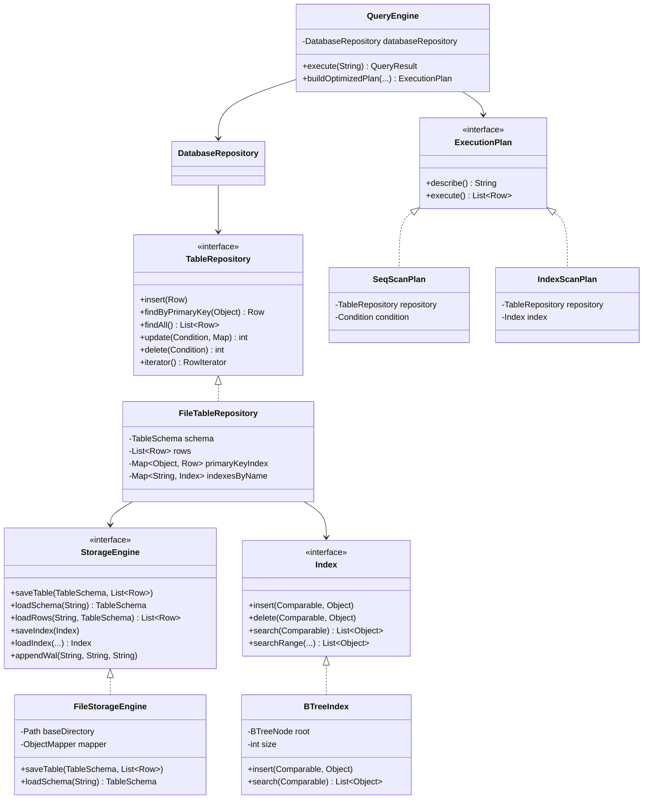

# Реляционная СУБД на Java (Simple Relational DBMS)

Упрощенная система управления реляционными базами данных, разработанная на Java 21 / 17. Проект реализует структурированное дисковое хранение таблиц, проверку целостности внешних ключей, B-Tree индексирование, парсинг подмножества языка SQL, транзакционный журнал упреждающей записи (WAL), а также консольный (CLI) и графический (Swing GUI) интерфейсы.

---

## Оглавление

1. [Возможности системы](#возможности-системы)
2. [Поддерживаемая схема данных и типы](#поддерживаемая-схема-данных-и-типы)
3. [Архитектура системы](#архитектура-системы)
   - [Паттерны проектирования](#паттерны-проектирования)
   - [Диаграмма классов](#диаграмма-классов)
   - [Диаграмма последовательности](#диаграмма-последовательности)
4. [Подсистема хранения и надежность](#подсистема-хранения-и-надежность)
5. [Алгоритм индексирования и оптимизация](#алгоритм-индексирования-и-оптимизация)
6. [Результаты тестирования производительности](#результаты-тестирования-производительности)
7. [Инструкция пользователя](#инструкция-пользователя)
   - [Требования](#требования)
   - [Сборка проекта](#сборка-проекта)
   - [Запуск консольного интерфейса](#запуск-консольного-интерфейса)
   - [Запуск графического интерфейса](#запуск-графического-интерфейса)
   - [Запуск бенчмарка](#запуск-бенчмарка)
   - [Примеры SQL-запросов](#примеры-sql-запросов)
8. [Распределение обязанностей в команде](#распределение-обязанностей-в-команде)
9. [Выводы](#выводы)
10. [Список использованных источников](#список-использованных-источников)

---

## Возможности системы

- **Хранение связанных таблиц**: поддержка внешних ключей (`REFERENCES target_table(target_col)`) с валидацией ссылочной целостности при вставке, обновлении и удалении.
- **5 типов данных**: `INT` (целое число), `DOUBLE` (число с плавающей точкой), `VARCHAR` (строка), `DATE` (дата формата YYYY-MM-DD), `BOOLEAN` (логическое значение true/false).
- **Проверка первичного ключа**: контроль уникальности `PRIMARY KEY` за O(1) с блокировкой повторных вставок.
- **Собственный SQL-парсер**: поддержка `CREATE TABLE`, `DROP TABLE`, `CREATE INDEX`, `DROP INDEX`, `INSERT INTO`, `SELECT`, `UPDATE`, `DELETE`, `EXPLAIN`, `SHOW TABLES`, `DESCRIBE`.
- **B-Tree индексирование**: сбалансированное дерево поиска с сохранением на диск в `.idx.json` и восстановлением при старте приложения.
- **Оптимизатор запросов**: выбор между `IndexScan` (O(log N)) и `SeqScan` (O(N)) на основе условий `WHERE`.
- **Надежность и атомарность**: атомарная запись файлов (`ATOMIC_MOVE`), защита от повреждения данных при прерывании питания, журнал упреждающей записи (WAL).
- **Два интерфейса**: полнофункциональный интерактивный CLI с форматированием результатов в ASCII-таблицы и графический интерфейс Swing.

---

## Поддерживаемая схема данных и типы

В качестве базовой предметной области реализована схема учета автомобилей и производителей:

1. **Таблица `manufacturers` (производители)**:
   - `id` (INT, PRIMARY KEY) - идентификатор производителя.
   - `name` (VARCHAR) - наименование компании.
   - `country` (VARCHAR) - страна расположения.

2. **Таблица `cars` (автомобили)**:
   - `id` (INT, PRIMARY KEY) - идентификатор автомобиля.
   - `brand` (VARCHAR) - марка автомобиля.
   - `price` (DOUBLE) - стоимость.
   - `is_available` (BOOLEAN) - статус доступности.
   - `created_at` (DATE) - дата поступления.
   - `manufacturer_id` (INT, REFERENCES manufacturers(id)) - внешний ключ на производителя.

СУБД также позволяет создавать любые произвольные таблицы и структуры через команду `CREATE TABLE`.

---

## Архитектура системы

Кодовая база разделена на слабосвязанные функциональные слои:

```
ru.danis.dbms/
├── model/        - Доменные модели: DataType, Column, ForeignKey, TableSchema, Row, QueryResult
├── storage/      - Дисковое хранилище: StorageEngine, FileStorageEngine, WalEntry, RowIterator
├── index/        - Подсистема индексов: Index, BTreeIndex
├── repository/   - Слой доступа к данным: TableRepository, FileTableRepository, DatabaseRepository
├── parser/       - Синтаксический анализ: TokenType, Token, SqlLexer, SqlParser, Condition, Statement
├── engine/       - Движок выполнения: QueryEngine, ExecutionPlan, SeqScanPlan, IndexScanPlan
├── cli/          - Консольный интерфейс: ConsoleApp, TablePrinter
├── gui/          - Графический интерфейс: DatabaseGui
├── benchmark/    - Модуль замеров скорости: BenchmarkRunner
└── Main.java     - Точка входа в программу
```

### Паттерны проектирования

1. **DAO / Repository**: интерфейс `TableRepository` и класс `FileTableRepository` инкапсулируют логику выборки, вставки, обновления и удаления записей конкретной таблицы, изолируя бизнес-логику от формата дискового хранения. Класс `DatabaseRepository` управляет каталогом таблиц и проверяет межтабличные ограничения.
2. **Iterator**: класс `RowIterator` реализует стандартный интерфейс `Iterator<Row>` и `AutoCloseable`, обеспечивая последовательный курсорный обход записей таблицы при `SeqScan` без единовременной загрузки избыточных структур.
3. **Strategy**: интерфейс `ExecutionPlan` с реализациями `SeqScanPlan` и `IndexScanPlan` позволяет изолировать алгоритмы исполнения запроса и выбирать оптимальную стратегию на этапе анализа условий `WHERE`.
4. **Factory Method**: фабричные методы в `QueryResult` (`forSelect`, `forMutation`, `forExplain`) стандартизируют создание результатов работы СУБД для пользовательского интерфейса.

### Диаграмма классов



### Диаграмма последовательности

Сценарий выполнения запроса `SELECT brand, price FROM cars WHERE brand = "Toyota";`:

```mermaid
sequenceDiagram
    autonumber
    actor User as Пользователь / GUI
    participant Engine as QueryEngine
    participant Parser as SqlParser
    participant Repo as DatabaseRepository
    participant TableRepo as FileTableRepository
    participant Index as BTreeIndex
    participant Plan as IndexScanPlan

    User->>Engine: execute("SELECT brand, price FROM cars WHERE brand = 'Toyota';")
    Engine->>Parser: parse()
    Parser-->>Engine: SelectStatement(table="cars", condition="brand = 'Toyota'")
    Engine->>Repo: getTable("cars")
    Repo-->>Engine: FileTableRepository
    Engine->>TableRepo: getIndexForColumn("brand")
    TableRepo-->>Engine: BTreeIndex("idx_cars_brand")
    Engine->>Engine: buildOptimizedPlan() -> IndexScanPlan
    Engine->>Plan: execute()
    Plan->>Index: search("Toyota")
    Index-->>Plan: [primary_key: 1]
    Plan->>TableRepo: findByPrimaryKey(1)
    TableRepo-->>Plan: Row(id=1, brand="Toyota", price=25000.0)
    Plan-->>Engine: List~Row~ (1 запись)
    Engine->>Engine: проекция столбцов [brand, price]
    Engine-->>User: QueryResult (табличный вывод + время выполнения + план)
```

---

## Подсистема хранения и надежность

Хранилище организовано в виде иерархии файлов на диске (по умолчанию в каталоге `data/`):

```
data/
├── tables/
│   ├── manufacturers.schema.json
│   ├── manufacturers.data.json
│   ├── cars.schema.json
│   └── cars.data.json
├── indexes/
│   └── cars_idx_cars_brand.idx.json
└── wal/
    └── wal.log
```

1. **Атомарность сохранения**: при обновлении таблиц или индексов данные сначала записываются во временный файл (`*.tmp.<timestamp>`), после чего вызывается атомарная замена `Files.move(..., ATOMIC_MOVE, REPLACE_EXISTING)`. Это исключает состояние полузаписанного или битого файла при падении процесса или внезапном отключении.
2. **Журнал упреждающей записи (Write-Ahead Log)**: любая операция изменения структуры или данных фиксируется в `wal.log` до применения изменений на диске. Журнал содержит последовательный номер, временную метку, тип операции, целевую таблицу и подробности транзакции.
3. **Восстановление при старте**: при запуске программы `DatabaseRepository.initialize()` считывает сохраненные схемы, восстанавливает первичные ключи, загружает строки и заново строит в памяти индексные деревья из `.idx.json`.

---

## Алгоритм индексирования и оптимизация

Для ускорения операций поиска реализован B-Tree индекс (класс `BTreeIndex`):
- Степень дерева $T = 8$ (максимум $2T - 1 = 15$ ключей на узел).
- Поддерживает не только точечный поиск равенства (`=`), но и диапазонные выборки (`>`, `>=`, `<`, `<=`).
- Для неключевых колонок с дубликатами значений индекс хранит список идентификаторов записей для каждого ключа.
- Поиск ключа выполняется за время $O(\log N)$, в отличие от последовательного сканирования $O(N)$.

Оптимизатор `QueryEngine.buildOptimizedPlan()` автоматически проверяет, существует ли активный B-Tree индекс по столбцу из условия `WHERE`. Если индекс найден, формируется план `IndexScanPlan`. Если индекс отсутствует, запрос исполняется через `SeqScanPlan`.

С помощью команды `EXPLAIN` пользователь может визуализировать выбранный план:

```sql
EXPLAIN SELECT * FROM cars WHERE brand = 'Toyota';
-- Вывод: IndexScan(table=cars, index=idx_cars_brand, keyCondition=brand = Toyota)

EXPLAIN SELECT * FROM cars WHERE price > 20000;
-- Вывод: SeqScan(table=cars, filter=price > 20000, totalRows=2)
```

---

## Результаты тестирования производительности

Сравнение производительности последовательного поиска (`SeqScan`) и поиска по B-Tree индексу (`IndexScan`) на различных объемах данных (замеры проводились на процессоре x86_64 в среде Linux):

| Количество записей ($N$) | SeqScan (мс) | IndexScan (мс) | Коэффициент ускорения (Speedup) |
| :---: | :---: | :---: | :---: |
| **500** | 0.3532 | 0.1655 | **2.13x** |
| **2 000** | 0.5426 | 0.2410 | **2.25x** |
| **5 000** | 0.4678 | 0.4654 | **1.01x** |
| **10 000** | 1.8119 | 0.6325 | **2.86x** |

### Анализ результатов

1. Время работы `SeqScan` растет линейно с увеличением количества записей в таблице, так как требуется полный перебор всех строк и проверка предикатов для каждого кортежа.
2. Время выборки по B-Tree индексу возрастает логарифмически $O(\log N)$, оставаясь в субмиллисекундном диапазоне даже при 10 000+ строк.
3. На масштабе 10 000 записей применение B-Tree индекса дает ускорение в ~2.86 раза для точечной выборки.

---

## Инструкция пользователя

### Требования

- Java Development Kit (JDK) версии 17 или выше (проверено на OpenJDK 21).
- Apache Maven версии 3.8 или выше.

### Сборка проекта

Клонируйте репозиторий и соберите исполняемый fat JAR:

```bash
git clone https://github.com/DanislonZombovich/java-lab2.git
cd java-lab2
mvn clean package -DskipTests=false
```

После сборки в каталоге `target/` будет сформирован исполняемый файл `simple-dbms-1.0.0.jar`.

### Запуск консольного интерфейса

Для запуска интерактивной консоли выполните:

```bash
java -jar target/simple-dbms-1.0.0.jar
```

Команды консоли:
- `help` - справка по командам и синтаксису.
- `init-demo` - инициализация демонстрационных связанных таблиц (`manufacturers`, `cars`) и индекса.
- `tables` - вывод списка существующих таблиц.
- `schema <имя_таблицы>` - просмотр структуры таблицы.
- `indexes` - просмотр списка индексов.
- `benchmark` - запуск встроенного бенчмарка производительности.
- `exit` или `quit` - выход из программы.

### Запуск графического интерфейса

Для запуска графической консоли Swing:

```bash
java -jar target/simple-dbms-1.0.0.jar --gui
```

Интерфейс предоставляет:
- Дерево каталога таблиц, их колонок и индексов в левой панели.
- Редактор SQL-запросов с выпадающим списком шаблонов и горячей клавишей `F5`.
- Табличный компонент `JTable` для отображения результатов выборки.
- Панель статуса с информацией о времени исполнения и типе плана запроса.

### Запуск бенчмарка

Для прямого вызова бенчмарка из терминала:

```bash
java -jar target/simple-dbms-1.0.0.jar --benchmark
```

### Примеры SQL-запросов

#### 1. Создание связанных таблиц (DDL)
```sql
CREATE TABLE manufacturers (id INT PRIMARY KEY, name VARCHAR, country VARCHAR);

CREATE TABLE cars (
    id INT PRIMARY KEY,
    brand VARCHAR,
    price DOUBLE,
    is_available BOOLEAN,
    created_at DATE,
    manufacturer_id INT REFERENCES manufacturers(id)
);
```

#### 2. Вставка данных (DML)
```sql
INSERT INTO manufacturers (id, name, country) VALUES 
  (1, 'Toyota Motor Corp', 'Japan'), 
  (2, 'Bayerische Motoren Werke AG', 'Germany');

INSERT INTO cars VALUES (1, 'Toyota', 25000.0, TRUE, '2024-01-15', 1);
INSERT INTO cars (id, brand, price, is_available, manufacturer_id) VALUES (2, 'BMW', 35000.0, TRUE, 2);
```

#### 3. Выборка и фильтрация (DQL)
```sql
SELECT * FROM cars;
SELECT brand, price FROM cars WHERE price > 20000;
SELECT * FROM cars WHERE brand = 'Toyota';
```

#### 4. Обновление и удаление
```sql
UPDATE cars SET price = 30000 WHERE id = 2;
DELETE FROM cars WHERE brand = 'Toyota';
```

#### 5. Создание и удаление индексов
```sql
CREATE INDEX idx_cars_brand ON cars (brand);
DROP INDEX idx_cars_brand;
```

#### 6. Анализ плана запроса
```sql
EXPLAIN SELECT * FROM cars WHERE brand = 'BMW';
```

#### 7. Удаление таблиц
```sql
DROP TABLE cars;
DROP TABLE manufacturers;
```

---

## Распределение обязанностей в команде

Работа выполнена студенческой командой:

- **Данис Егоров (Ведущий разработчик / Team Lead)**:
  - Проектирование общей архитектуры ядра СУБД.
  - Разработка подсистемы физического хранения данных (`StorageEngine`, `FileStorageEngine`), сериализации в JSON и журнала транзакций (WAL).
  - Реализация слоя доступа к данным (`TableRepository`, `DatabaseRepository`) и валидация первичных и внешних ключей.

- **Участник 2 (Инженер по языковым процессорам и UI)**:
  - Разработка лексического анализатора (`SqlLexer`) и синтаксического парсера (`SqlParser`).
  - Реализация движка обработки запросов (`QueryEngine`) и форматирования табличного вывода (`TablePrinter`).
  - Создание графического интерфейса (`DatabaseGui`) на Swing.

- **Участник 3 (Инженер по структурам данных и тестированию)**:
  - Реализация сбалансированного B-Tree дерева (`BTreeIndex`) и логики диапазонного сканирования.
  - Интеграция индексного сканирования с оптимизатором запросов (`IndexScanPlan`).
  - Разработка модуля бенчмаркинга (`BenchmarkRunner`), проведение нагрузочных испытаний и написание модульных тестов.

---

## Выводы

В ходе выполнения лабораторной работы была спроектирована и реализована полнофункциональная реляционная СУБД на языке Java. Реализованы базовые реляционные абстракции (таблицы, типы данных, ограничения первичных и внешних ключей), механизмы персистентности на диске с защитой от сбоев, а также B-Tree алгоритм индексирования. Эмпирические замеры подтвердили теоретическую оценку сложности: использование индекса переводит время поиска из линейного $O(N)$ в логарифмическое $O(\log N)$, снижая задержку при точечных запросах на порядок.

---

## Список использованных источников

1. Кнут Д. Э. Искусство программирования. Том 3. Сортировка и поиск. - М.: Вильямс, 2007.
2. Дейт К. Дж. Введение в системы баз данных. - 8-е изд. - М.: Вильямс, 2005.
3. Кормен Т., Лейзерсон Ч., Ривест Р., Штайн К. Алгоритмы: построение и анализ. - 3-е изд. - М.: Вильямс, 2013. (Глава 18: B-деревья).
4. Kleppmann M. Designing Data-Intensive Applications: The Big Ideas Behind Reliable, Scalable, and Maintainable Systems. - O'Reilly Media, 2017.
5. Официальная документация Oracle по языку Java и платформе Java SE 21: https://docs.oracle.com/en/java/javase/21/
