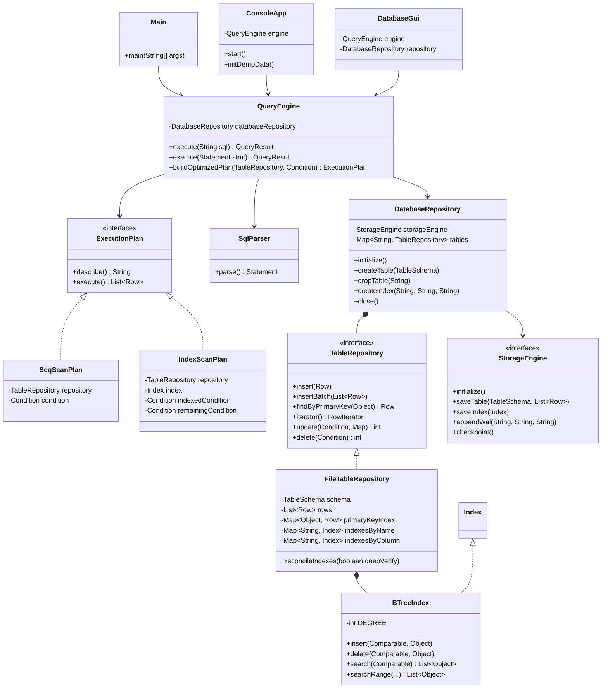
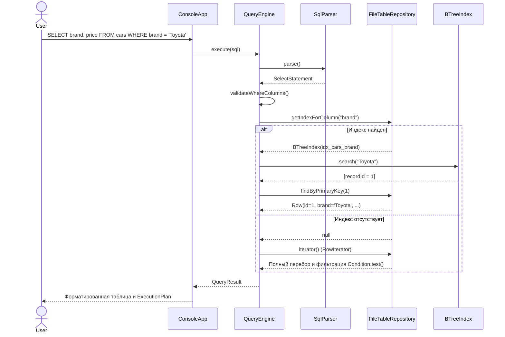
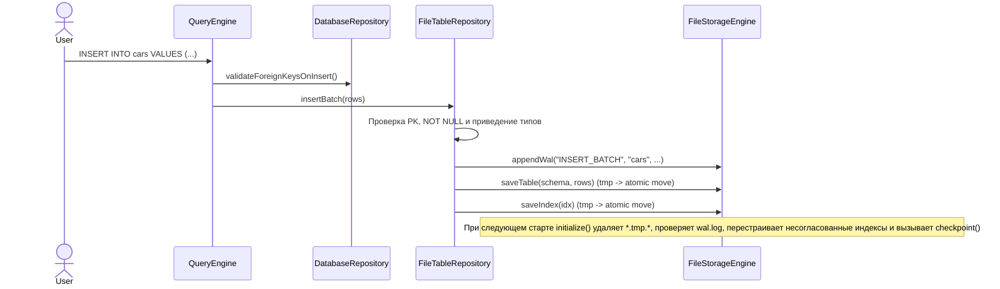

# Упрощенная реляционная СУБД на Java (Simple DBMS)

Лабораторная работа N2. Система управления базами данных на языке Java (стек Java 17, Jackson, JUnit 5, Maven) с хранением таблиц и индексов на диске, журналом предзаписи (WAL), SQL-подобным парсером, B-Tree индексацией, проверкой внешних ключей, консольным (CLI) и графическим (Swing) интерфейсами.

---

## Содержание

1. [Возможности системы](#1-возможности-системы)
2. [Архитектура системы](#2-архитектура-системы)
3. [Инструкция пользователя](#3-инструкция-пользователя)
4. [Результаты тестирования производительности](#4-результаты-тестирования-производительности)
5. [Команда и распределение файлов для нового репозитория](#5-команда-и-распределение-файлов-для-нового-репозитория)
6. [Выводы](#6-выводы)
7. [Список использованных источников](#7-список-использованных-источников)

---

## 1. Возможности системы

- **Хранение и типы данных**:
  - Поддерживаемые типы: `INT` (Long), `DOUBLE` (Double), `VARCHAR` (String), `DATE` (`LocalDate`, формат ISO-8601 `YYYY-MM-DD`), `BOOLEAN` (Boolean).
  - Ограничения целостности: `PRIMARY KEY`, `NOT NULL`, `REFERENCES <table>(<column>)`.
  - Внешние ключи проверяются при операциях `INSERT`, `UPDATE`, `DELETE` и `DROP TABLE`.
- **Персистентность и восстановление после сбоя**:
  - Схемы и строки таблиц сериализуются в JSON (`data/tables/*.schema.json`, `data/tables/*.data.json`) с использованием Jackson.
  - Индексы сериализуются отдельно (`data/indexes/*.idx.json`).
  - Запись выполняется атомарно через временный файл `*.tmp.*` и переименование. При старте `FileStorageEngine` удаляет незавершенные временные файлы.
  - Журнал предзаписи (`data/wal/wal.log`) фиксирует DDL и DML операции до сброса на диск. Если при запуске журнал не пуст или содержит незавершенную оборванную строку после сбоя, система пропускает поврежденный хвост, выполняет глубокую сверку индексов с данными таблиц и сбрасывает контрольную точку (`checkpoint()`).
- **SQL-парсер и оптимизатор**:
  - DDL: `CREATE TABLE [IF NOT EXISTS]`, `DROP TABLE [IF EXISTS]`, `CREATE INDEX [IF NOT EXISTS] ... ON ...`, `DROP INDEX [IF EXISTS]`. Поддерживаются параметры длины и точности типов вида `VARCHAR(50)` и `DECIMAL(10, 2)`.
  - DML: `INSERT INTO` (полные кортежи, явный список столбцов, пакетная вставка через запятую), `SELECT` (`*` или проекция столбцов, `WHERE`), `UPDATE ... SET ... WHERE`, `DELETE FROM ... WHERE`.
  - Предикаты `WHERE`: `=`, `!=`, `<>`, `>`, `>=`, `<`, `<=`, `IS NULL`, `IS NOT NULL`, логические связки `AND` (более высокий приоритет) и `OR`, скобки `(...)`, однострочные SQL-комментарии `--`.
  - Служебные команды: `SHOW TABLES`, `SHOW INDEXES [FROM|IN <table>]`, `DESCRIBE <table>` / `DESC <table>`, `EXPLAIN <SELECT ...>`.
  - План выполнения: если в `WHERE` присутствует условие по проиндексированному столбцу (и значение не `NULL`), оптимизатор выбирает `IndexScanPlan` по B-дереву; иначе используется `SeqScanPlan` через `RowIterator`.
- **B-Tree индекс (`BTreeIndex`)**:
  - Сбалансированное B-дерево с минимальной степенью `t = 8` (до 15 ключей и 16 потомков в узле), поддержкой дубликатов ключей, точечного поиска `search()` и диапазонного поиска `searchRange()`.
  - Удаление ключей реализовано напрямую на структуре дерева за `O(log N)` с заимствованием у соседей и слиянием узлов без полной перестройки индекса.

---

## 2. Архитектура системы

Проект разделен на слои в пакете `ru.danis.dbms`:

- `model` - модели данных (`DataType`, `Column`, `ForeignKey`, `TableSchema`, `Row`, `QueryResult`).
- `storage` - подсистема дискового ввода-вывода и WAL (`StorageEngine`, `FileStorageEngine`, `WalEntry`, `RowIterator`).
- `index` - структура индексирования (`Index`, `BTreeIndex`).
- `repository` - паттерн Repository для таблиц и координации связей (`TableRepository`, `FileTableRepository`, `DatabaseRepository`).
- `parser` и `parser.statement` - лексический анализатор, рекурсивный парсер, деревья условий `Condition` и AST-классы команд.
- `engine` - планировщик и исполнитель (`QueryEngine`, `ExecutionPlan`, `SeqScanPlan`, `IndexScanPlan`).
- `cli`, `gui`, `benchmark` - консольный REPL (`ConsoleApp`, `TablePrinter`), Swing-интерфейс (`DatabaseGui`), замер производительности (`BenchmarkRunner`) и точка входа (`Main`).

### Диаграмма классов



### Диаграмма последовательности: выполнение `SELECT` с индексом и без индекса



### Диаграмма последовательности: вставка записи, WAL и восстановление



---

## 3. Инструкция пользователя

### Требования и сборка

- Java 17 или новее (целевая версия сборки в `pom.xml` - 17).
- Apache Maven 3.8+.

Сборка исполняемого JAR с зависимостями и запуск модульных тестов (48 тестов в 7 классах):

```bash
mvn clean package
```

Генерация Javadoc (собирается без предупреждений):

```bash
mvn javadoc:javadoc
```

### Режимы запуска

1. **Интерактивная консоль (CLI)**:
```bash
java -jar target/simple-dbms-1.0.0.jar
```
С указанием отдельного каталога данных:
```bash
java -jar target/simple-dbms-1.0.0.jar --data ./my_data
```

2. **Графический интерфейс (Swing)**:
```bash
java -jar target/simple-dbms-1.0.0.jar --gui
```

3. **Инициализация демонстрационных таблиц `manufacturers` и `cars`**:
```bash
java -jar target/simple-dbms-1.0.0.jar --init-demo
```

4. **Запуск теста производительности (SeqScan vs B-Tree IndexScan)**:
```bash
java -jar target/simple-dbms-1.0.0.jar --benchmark
```

### Консольные команды и примеры SQL-запросов

Служебные команды в CLI (допускается точка с запятой на конце или без нее):
- `help` - список поддерживаемых конструкций SQL и команд;
- `init-demo` - создать таблицы `manufacturers` и `cars` со связью по внешнему ключу и индексом (повторный вызов безопасен);
- `tables` - список таблиц (`SHOW TABLES;`);
- `indexes` - список индексов (`SHOW INDEXES;`);
- `schema <таблица>` - структура таблицы (`DESCRIBE <таблица>;`);
- `benchmark` - выполнить замер скорости индексного и последовательного сканирования;
- `exit` / `quit` - закрыть базу с сохранением контрольной точки WAL и выйти.

SQL-операторы необходимо завершать символом `;`:

```sql
CREATE TABLE manufacturers (
    id INT PRIMARY KEY,
    name VARCHAR(100) NOT NULL,
    country VARCHAR
);

CREATE TABLE cars (
    id INT PRIMARY KEY,
    brand VARCHAR NOT NULL,
    price DOUBLE,
    is_available BOOLEAN,
    created_at DATE,
    manufacturer_id INT REFERENCES manufacturers(id)
);

CREATE INDEX idx_cars_brand ON cars (brand);

INSERT INTO manufacturers VALUES (1, 'Toyota Motor Corp', 'Japan');
INSERT INTO cars VALUES (1, 'Toyota', 25000.0, TRUE, '2024-01-15', 1);
INSERT INTO cars (id, brand) VALUES (2, 'BMW');

SELECT * FROM cars;
SELECT brand, price FROM cars WHERE (brand = 'Toyota' OR brand = 'BMW') AND price > 20000;
EXPLAIN SELECT * FROM cars WHERE brand = 'Toyota';

UPDATE cars SET price = 30000 WHERE id = 2;
DELETE FROM cars WHERE brand = 'Toyota';
```

---

## 4. Результаты тестирования производительности

Замеры выполнялись командой `java -jar target/simple-dbms-1.0.0.jar --benchmark` (`BenchmarkRunner`):
- Схема тестовой таблицы: `(id INT PRIMARY KEY, brand VARCHAR, price DOUBLE, is_available BOOLEAN)`.
- Кардинальность индексируемого поля `brand`: 100 уникальных значений (`Brand_000`..`Brand_099`, селективность около 1%).
- Методика: 20 прогревочных выполнений запроса перед каждым замером (для JIT-компиляции HotSpot), затем усреднение по 50 последовательным запросам `SELECT * FROM bench_<N> WHERE brand = 'Brand_042';` до создания индекса (`SeqScan`) и после `CREATE INDEX` (`IndexScan`).

| Записей (N) | SeqScan (ms) | IndexScan (ms) | Ускорение |
|-------------|--------------|----------------|-----------|
| 500         | 0.2511       | 0.0475         | 5.28x     |
| 2000        | 0.1320       | 0.0410         | 3.22x     |
| 5000        | 0.7965       | 0.0724         | 11.01x    |
| 10000       | 1.5673       | 0.0675         | 23.23x    |

Анализ результатов: время полного перебора (`SeqScan`) растет линейно с размером таблицы (до `1.5673 ms` при 10 000 строках), тогда как поиск по B-дереву (`IndexScan`) остается в пределах `0.04 - 0.07 ms` за счет логарифмической высоты дерева и O(1)-доступа по первичному ключу.

---

## 5. Команда и распределение файлов для нового репозитория

Для командной сдачи создан отдельный репозиторий: `https://github.com/DanislonZombovich/simple-dbms`.
Ниже распределены все 53 отслеживаемых файла проекта между тремя участниками без пропусков и пересечений.

> **Техническое замечание по порядку коммитов**: модули хранения и репозиториев (`storage`, `repository`) используют интерфейс `Index`, класс `BTreeIndex` и дерево условий `Condition`. Поэтому Даниил (шаг 1) коммитит базовую конфигурацию проекта и свой слой первым, после коммита Егора (шаг 2) проект начинает компилироваться (`mvn compile`), а после коммита Максима (шаг 3) собирается полностью и проходят все 48 тестов (`mvn test`).

### Участник 1: Даниил Егоров - Модели, подсистема хранения, WAL, репозитории и конфиг проекта (УЖЕ ЗАКОММИЧЕНО)

**Ответственность**: архитектура хранения на диске, модели типов данных и таблиц, атомарное сохранение, WAL и восстановление при перезапуске, проверка ссылочной целостности внешних ключей, стартовый `pom.xml`, `.gitignore` и краткий `README.md`.

**Файлы (12 Java-файлов + 3 проектных файла)**:
- `.gitignore`
- `pom.xml`
- `README.md` (краткое описание проекта и инструкции для пользователей)
- `src/main/java/ru/danis/dbms/model/DataType.java`
- `src/main/java/ru/danis/dbms/model/Column.java`
- `src/main/java/ru/danis/dbms/model/ForeignKey.java`
- `src/main/java/ru/danis/dbms/model/TableSchema.java`
- `src/main/java/ru/danis/dbms/model/Row.java`
- `src/main/java/ru/danis/dbms/storage/StorageEngine.java`
- `src/main/java/ru/danis/dbms/storage/FileStorageEngine.java`
- `src/main/java/ru/danis/dbms/storage/WalEntry.java`
- `src/main/java/ru/danis/dbms/storage/RowIterator.java`
- `src/main/java/ru/danis/dbms/repository/TableRepository.java`
- `src/main/java/ru/danis/dbms/repository/FileTableRepository.java`
- `src/main/java/ru/danis/dbms/repository/DatabaseRepository.java`

### Участник 2: Егор Глазов - Индексы B-Tree, лексер, SQL-парсер и AST-команды

**Ответственность**: реализация B-Tree индекса сбалансированного порядка (`insert`, `search`, `searchRange`, CLRS `delete`), лексический анализ, рекурсивный спуск с приоритетами `AND`/`OR` и скобками, классы SQL-выражений и `QueryResult`.

**Файлы (22 Java-файла)**:
- `src/main/java/ru/danis/dbms/model/QueryResult.java`
- `src/main/java/ru/danis/dbms/index/Index.java`
- `src/main/java/ru/danis/dbms/index/BTreeIndex.java`
- `src/main/java/ru/danis/dbms/parser/TokenType.java`
- `src/main/java/ru/danis/dbms/parser/Token.java`
- `src/main/java/ru/danis/dbms/parser/SqlLexer.java`
- `src/main/java/ru/danis/dbms/parser/ComparisonOperator.java`
- `src/main/java/ru/danis/dbms/parser/Condition.java`
- `src/main/java/ru/danis/dbms/parser/SqlParser.java`
- `src/main/java/ru/danis/dbms/parser/statement/Statement.java`
- `src/main/java/ru/danis/dbms/parser/statement/CreateTableStatement.java`
- `src/main/java/ru/danis/dbms/parser/statement/DropTableStatement.java`
- `src/main/java/ru/danis/dbms/parser/statement/CreateIndexStatement.java`
- `src/main/java/ru/danis/dbms/parser/statement/DropIndexStatement.java`
- `src/main/java/ru/danis/dbms/parser/statement/InsertStatement.java`
- `src/main/java/ru/danis/dbms/parser/statement/SelectStatement.java`
- `src/main/java/ru/danis/dbms/parser/statement/UpdateStatement.java`
- `src/main/java/ru/danis/dbms/parser/statement/DeleteStatement.java`
- `src/main/java/ru/danis/dbms/parser/statement/DescribeTableStatement.java`
- `src/main/java/ru/danis/dbms/parser/statement/ExplainStatement.java`
- `src/main/java/ru/danis/dbms/parser/statement/ShowTablesStatement.java`
- `src/main/java/ru/danis/dbms/parser/statement/ShowIndexesStatement.java`

**Инструкция коммита для Егора**:
```bash
git clone https://github.com/DanislonZombovich/simple-dbms.git
cd simple-dbms
git pull origin main

# Скопировать перечисленные 22 файла из готового проекта (java-lab2), затем:
git add src/main/java/ru/danis/dbms/model/QueryResult.java \
        src/main/java/ru/danis/dbms/index/ \
        src/main/java/ru/danis/dbms/parser/
git commit -m "feat(index,parser): implement B-Tree index, SQL lexer, parser, and statement AST"
git push origin main
```

### Участник 3: Максим Жулин - Движок запросов, оптимизатор, CLI/GUI, бенчмарк и тесты

**Ответственность**: исполнительный движок `QueryEngine`, выбор плана `IndexScanPlan`/`SeqScanPlan`, консольный REPL и ASCII-таблицы, Swing-интерфейс, стенд `BenchmarkRunner`, точка входа `Main` и полный набор модульных тестов (48 тестов).

**Файлы (9 основных Java-файлов + 7 тестовых файлов)**:
- `src/main/java/ru/danis/dbms/engine/ExecutionPlan.java`
- `src/main/java/ru/danis/dbms/engine/SeqScanPlan.java`
- `src/main/java/ru/danis/dbms/engine/IndexScanPlan.java`
- `src/main/java/ru/danis/dbms/engine/QueryEngine.java`
- `src/main/java/ru/danis/dbms/cli/TablePrinter.java`
- `src/main/java/ru/danis/dbms/cli/ConsoleApp.java`
- `src/main/java/ru/danis/dbms/gui/DatabaseGui.java`
- `src/main/java/ru/danis/dbms/benchmark/BenchmarkRunner.java`
- `src/main/java/ru/danis/dbms/Main.java`
- `src/test/java/ru/danis/dbms/DataTypeTest.java`
- `src/test/java/ru/danis/dbms/BTreeIndexTest.java`
- `src/test/java/ru/danis/dbms/SqlParserTest.java`
- `src/test/java/ru/danis/dbms/StorageEngineTest.java`
- `src/test/java/ru/danis/dbms/ForeignKeyTest.java`
- `src/test/java/ru/danis/dbms/QueryEngineTest.java`
- `src/test/java/ru/danis/dbms/EdgeCaseAndIntegrityTest.java`

**Инструкция коммита для Максима (после пуша Егора)**:
```bash
git clone https://github.com/DanislonZombovich/simple-dbms.git
cd simple-dbms
git pull origin main

# Скопировать перечисленные 16 Java-файлов из готового проекта (java-lab2) и проверить сборку:
mvn clean test

git add src/main/java/ru/danis/dbms/engine/ \
        src/main/java/ru/danis/dbms/cli/ \
        src/main/java/ru/danis/dbms/gui/ \
        src/main/java/ru/danis/dbms/benchmark/ \
        src/main/java/ru/danis/dbms/Main.java \
        src/test/java/ru/danis/dbms/
git commit -m "feat(engine,ui,tests): add query engine, CLI/GUI, benchmark, and test suite"
git push origin main
```

---

## 6. Выводы

В ходе выполнения лабораторной работы разработана модульная реляционная СУБД на Java с дисковым хранением таблиц, проверкой внешних ключей и B-Tree индексацией. Атомарная запись через временные файлы, журнал предзаписи и сверка индексов при инициализации обеспечивают целостность данных при повторном запуске. Наличие индекса по столбцу сократило время селективной выборки на таблице из 10 000 записей с `1.5673 ms` до `0.0675 ms` (ускорение в 23.23 раза), а автоматизированное тестирование (48 тестов JUnit 5) подтверждает корректность парсера, B-дерева и ограничений целостности.

---

## 7. Список использованных источников

1. Cormen T.H., Leiserson C.E., Rivest R.L., Stein C. Introduction to Algorithms (4th Edition). MIT Press, 2022. Chapter 18: B-Trees.
2. Garcia-Molina H., Ullman J.D., Widom J. Database Systems: The Complete Book (2nd Edition). Pearson, 2008.
3. Oracle Java Platform, Standard Edition 17 API Specification - `java.nio.file`, `java.time.LocalDate`, Swing.
4. FasterXML Jackson Project Documentation - `jackson-databind` 2.18, `jackson-datatype-jsr310`.
5. JUnit 5 User Guide - `https://junit.org/junit5/docs/current/user-guide/`.
