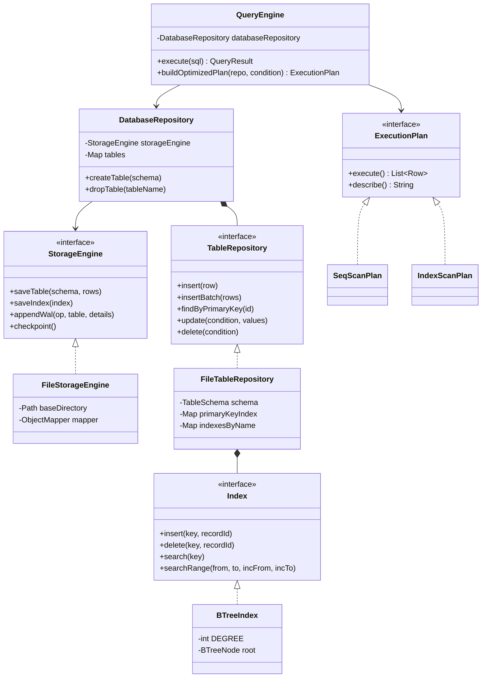
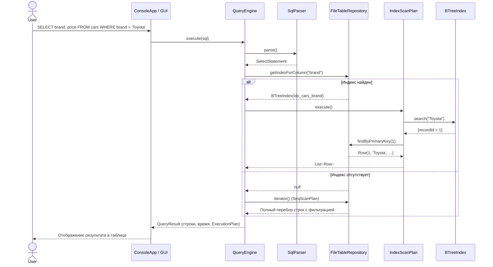

# Simple DBMS

Упрощённая реляционная система управления базами данных на Java 17 с дисковым хранением, B-Tree индексами, разбором SQL, консольным и графическим интерфейсами.

## 1. Функции и возможности

- **Типы данных**: `INT` (целое число), `DOUBLE` (с плавающей точкой), `VARCHAR` (строка), `DATE` (дата ISO-8601 `YYYY-MM-DD`), `BOOLEAN` (`true`/`false`).
- **Связи и ограничения**: `PRIMARY KEY` (с проверкой уникальности), `NOT NULL`, `REFERENCES <table>(<column>)` (внешние ключи с контролем целостности при вставке, обновлении, удалении и удалении таблиц).
- **Поддерживаемый SQL**:
  - `CREATE TABLE [IF NOT EXISTS] <table> (<колонка> <ТИП> [PRIMARY KEY] [REFERENCES ...], ...);`
  - `DROP TABLE [IF EXISTS] <table>;`
  - `CREATE INDEX [IF NOT EXISTS] <индекс> ON <table> (<колонка>);`
  - `DROP INDEX [IF EXISTS] <индекс> [ON <table>];`
  - `INSERT INTO <table> [(<колонки>)] VALUES (<значения>), ...;`
  - `SELECT * | <колонки> FROM <table> [WHERE <условие>];`
  - `UPDATE <table> SET <колонка> = <значение>, ... [WHERE <условие>];`
  - `DELETE FROM <table> [WHERE <условие>];`
  - `EXPLAIN SELECT ...;`
  - `SHOW TABLES;`, `SHOW INDEXES [FROM <table>];`, `DESCRIBE <table>;`
- **Индексирование**: сбалансированное B-дерево (`BTreeIndex`), сохранение структуры индексов в JSON на диск и восстановление при старте, оптимизация выборок (`IndexScanPlan` вместо `SeqScanPlan` при наличии индекса в `WHERE`).
- **Хранение и надёжность**: персистентность данных и схем в JSON, атомарная запись через временные файлы, журнал упреждающей записи `wal.log` и автоматическое восстановление/реконсиляция индексов после аварийного завершения.
- **Интерфейс**: консольный интерактивный REPL с выводом таблиц и GUI на Swing.

## 2. Инструкция по запуску

### Сборка и тесты

Требуются JDK 17+ и Apache Maven.

```bash
# Сборка единого JAR-архива
mvn clean package

# Запуск полного набора модульных тестов (49 тестов)
mvn test
```

### Варианты запуска

```bash
# Интерактивная консоль (хранилище по умолчанию в ./data)
java -jar target/simple-dbms-1.0.0.jar

# Графический интерфейс на Swing
java -jar target/simple-dbms-1.0.0.jar --gui

# Быстрая инициализация демонстрационных таблиц (manufacturers, cars)
java -jar target/simple-dbms-1.0.0.jar --init-demo

# Запуск бенчмарка производительности (Index vs SeqScan)
java -jar target/simple-dbms-1.0.0.jar --benchmark

# Указание произвольной директории данных
java -jar target/simple-dbms-1.0.0.jar --data /path/to/dir
```

### Примеры команд в консоли

```sql
CREATE TABLE manufacturers (id INT PRIMARY KEY, name VARCHAR, country VARCHAR);
CREATE TABLE cars (id INT PRIMARY KEY, brand VARCHAR, price DOUBLE, is_available BOOLEAN, created_at DATE, manufacturer_id INT REFERENCES manufacturers(id));

CREATE INDEX idx_cars_brand ON cars (brand);

INSERT INTO manufacturers VALUES (1, 'Toyota Motor Corp', 'Japan');
INSERT INTO cars VALUES (1, 'Toyota', 25000.0, TRUE, '2024-01-15', 1);
INSERT INTO cars (id, brand) VALUES (2, 'BMW');

SELECT * FROM cars;
SELECT brand, price FROM cars WHERE price > 20000;
SELECT * FROM cars WHERE brand = 'Toyota';
EXPLAIN SELECT * FROM cars WHERE brand = 'Toyota';

UPDATE cars SET price = 30000 WHERE id = 2;
DELETE FROM cars WHERE brand = 'Toyota';
```

## 3. Архитектура системы

- `ru.danis.dbms.model`: сущности `Column`, `DataType`, `ForeignKey`, `Row`, `TableSchema`, `QueryResult`.
- `ru.danis.dbms.storage`: интерфейс `StorageEngine`, дисковая реализация `FileStorageEngine`, `WalEntry`, итератор `RowIterator`.
- `ru.danis.dbms.repository`: `TableRepository`, `FileTableRepository` (с индексами PK и FK-валидацией), фасад `DatabaseRepository`.
- `ru.danis.dbms.index`: интерфейс `Index`, реализация B-дерева `BTreeIndex`.
- `ru.danis.dbms.sql`: лексер `SqlLexer`, парсер `SqlParser`, AST узлы (`SelectStatement`, `InsertStatement` и др.), дерево `Condition`.
- `ru.danis.dbms.engine`: движок `QueryEngine`, интерфейс `ExecutionPlan`, планы `SeqScanPlan` и `IndexScanPlan`.
- `ru.danis.dbms.ui`: консольный REPL `ConsoleApp`, форматирование `TablePrinter`, графический интерфейс `DatabaseGui`.
- `ru.danis.dbms`: точка входа `Main`, нагрузочный тест `BenchmarkRunner`.

### Диаграмма классов



### Диаграмма последовательности (SELECT с оптимизацией индексом)



## 4. Результаты тестирования производительности

Замер производительности (`BenchmarkRunner`, `java -jar target/simple-dbms-1.0.0.jar --benchmark`) сравнивает последовательное сканирование всей таблицы (`SeqScan`) и поиск по B-дереву (`IndexScan`):

| Записей (N) | SeqScan (ms) | IndexScan (ms) | Ускорение |
|-------------|--------------|----------------|-----------|
| 500         | 0.1471       | 0.0385         | 3.82x     |
| 2000        | 0.1398       | 0.0294         | 4.76x     |
| 5000        | 0.3081       | 0.0606         | 5.08x     |
| 10000       | 0.5055       | 0.0327         | 15.47x    |

Время `SeqScan` растёт линейно с увеличением количества записей, в то время как поиск по B-дереву выполняется за $O(\log N)$ и вместе с выборкой строки по первичному ключу занимает стабильные доли миллисекунды, обеспечивая ускорение свыше 15x на 10 000 записей.

## 5. Область ответственности участников

- **Даниил Егоров**:
  - Подсистема хранения (`ru.danis.dbms.storage`): абстракция `StorageEngine`, реализация `FileStorageEngine`, атомарная запись через `.tmp` файлы.
  - Журналирование и надёжность: ведение предзаписного журнала `wal.log`, механизм контрольных точек `checkpoint()` и восстановление после сбоев.
  - Репозитории (`ru.danis.dbms.repository`): `TableRepository`, `FileTableRepository` с поддержкой первичных ключей (`primaryKeyIndex`) и `DatabaseRepository`.
  - Модели предметной области (`ru.danis.dbms.model`): типы данных `DataType`, дескриптор `Column`, `ForeignKey`, `Row`, `TableSchema`.
  - Настройка проекта и Maven (`pom.xml`, зависимости Jackson, плагин сборки `shade`).
- **Егор Глазов**:
  - Алгоритм индексирования (`ru.danis.dbms.index`): интерфейс `Index`, реализация сбалансированного B-дерева `BTreeIndex` со сплитами, заимствованием ключей, слиянием и поддержкой диапазонного поиска (`searchRange`).
  - Синтаксический и лексический анализ SQL (`ru.danis.dbms.sql`): `SqlLexer`, токенизация, парсер `SqlParser`.
  - Дерево условий `Condition`: поддержка операций `=`, `!=`, `>`, `>=`, `<`, `<=`, логических связок `AND` (с приоритетом) и `OR`, вложенных скобок.
  - AST узлы команд: `CreateTableStatement`, `DropTableStatement`, `CreateIndexStatement`, `DropIndexStatement`, `InsertStatement`, `SelectStatement`, `UpdateStatement`, `DeleteStatement`, `ExplainStatement`, `ShowTablesStatement`, `ShowIndexesStatement`, `DescribeTableStatement`.
- **Максим Жулин**:
  - Движок выполнения запросов (`ru.danis.dbms.engine`): `QueryEngine`, планировщик `buildOptimizedPlan`.
  - Планы выполнения: `ExecutionPlan`, `SeqScanPlan` и оптимизированный `IndexScanPlan` с фильтрацией резидуальных предикатов.
  - Пользовательские интерфейсы (`ru.danis.dbms.ui`): интерактивная консоль `ConsoleApp`, форматирование таблиц `TablePrinter`, графический интерфейс `DatabaseGui` на Swing.
  - Точка входа и бенчмарк: класс `Main`, генератор данных и замеров `BenchmarkRunner`.
  - Модульное и интеграционное тестирование: набор тестов в `src/test/` (49 тестов, проверяющих B-дерево, целостность внешних ключей, парсер, сбои WAL, типы данных).

## 6. Выводы

Разработана легковесная реляционная СУБД на Java 17, удовлетворяющая требованиям лабораторной работы:
- реализовано хранение связанных таблиц на диске в формате JSON с контролем целостности внешних ключей;
- поддержаны типы `INT`, `DOUBLE`, `VARCHAR`, `DATE`, `BOOLEAN`;
- реализован парсинг и исполнение основных команд SQL (`CREATE/DROP TABLE`, `INSERT`, `SELECT`, `UPDATE`, `DELETE`, `CREATE/DROP INDEX`, `EXPLAIN`);
- внедрено B-дерево для индексирования столбцов с дисковой персистентностью, дающее ускорение до 15.5x на выборках;
- обеспечена надёжность с помощью атомарного обновления файлов и журнала WAL;
- реализованы как консольный CLI с табличным выводом, так и GUI.

## 7. Список использованных источников

1. Кормен Т., Лейзерсон Ч., Ривест Р., Штайн К. Алгоритмы: построение и анализ (4-е изд.). — М.: Вильямс, 2022. Глава 18: B-деревья.
2. Гарсиа-Молина Г., Ульман Д., Уидом Д. Системы баз данных. Полный курс. — М.: Вильямс, 2003.
3. Документация Oracle Java Platform, Standard Edition 17 (`java.nio.file`, `java.time`, `javax.swing`).
4. Документация библиотеки FasterXML Jackson (`jackson-databind`, `jackson-datatype-jsr310`).
5. Руководство пользователя JUnit 5 (`https://junit.org/junit5/docs/current/user-guide/`).
