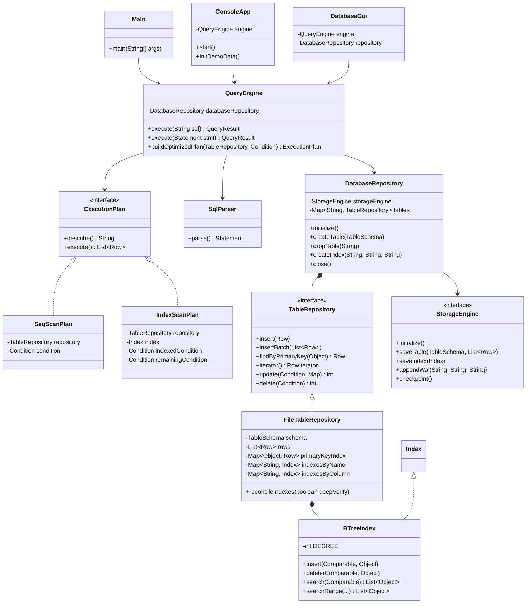
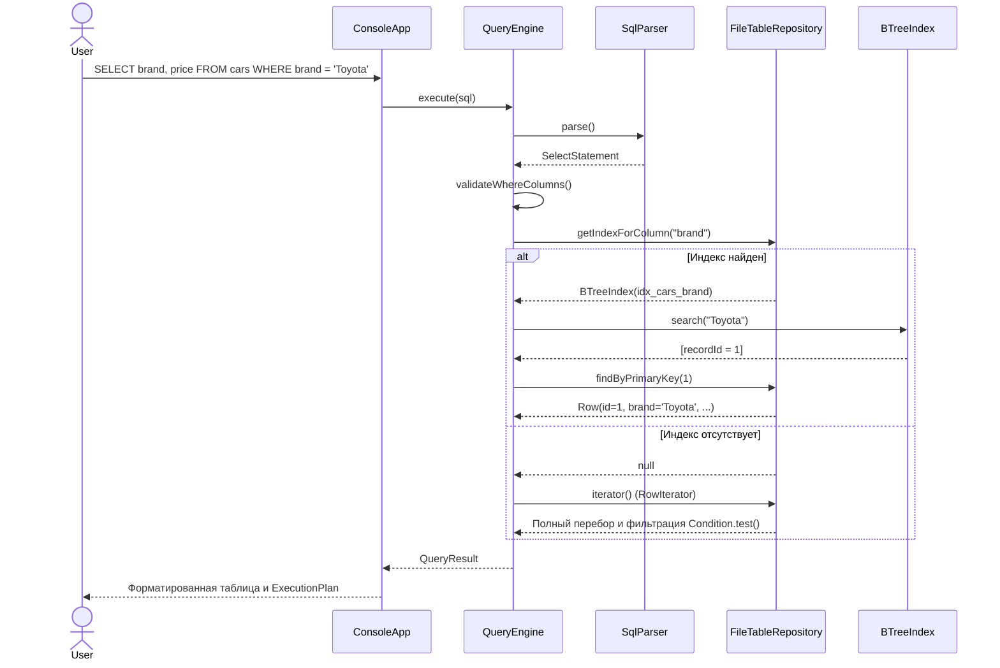
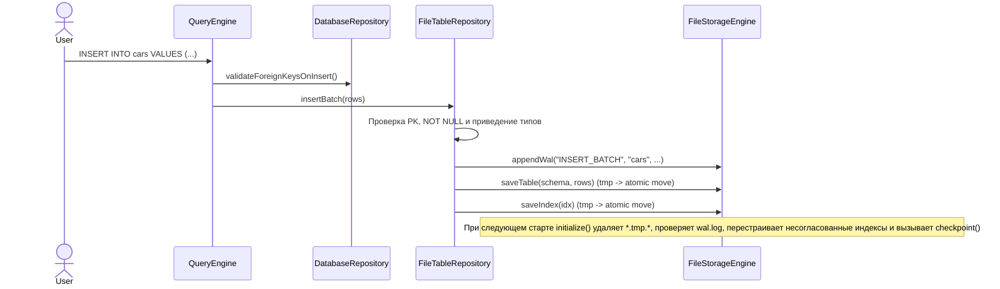

# Упрощенная реляционная СУБД на Java (Simple DBMS)

Лабораторная работа N2 по разработке упрощенной реляционной системы управления базами данных на Java 17. Программа хранит схемы, строки и индексы на диске в JSON, ведет журнал предзаписи (WAL), разбирает SQL-подобные запросы, проверяет первичные и внешние ключи, строит B-Tree индексы и работает через консоль или окно Swing.

## Содержание

1. [Возможности системы](#1-возможности-системы)
2. [Архитектура системы](#2-архитектура-системы)
3. [Инструкция пользователя](#3-инструкция-пользователя)
4. [Результаты тестирования производительности](#4-результаты-тестирования-производительности)
5. [Команда и распределение файлов для нового репозитория](#5-команда-и-распределение-файлов-для-нового-репозитория)
6. [Выводы](#6-выводы)
7. [Список использованных источников](#7-список-использованных-источников)

## 1. Возможности системы

### Типы данных и целостность

Таблицы поддерживают пять типов столбцов: `INT` (хранится как `Long`), `DOUBLE` (`Double`), `VARCHAR` (`String`), `DATE` (`LocalDate` в формате ISO-8601 `YYYY-MM-DD`) и `BOOLEAN` (`Boolean`). При описании столбца можно указать `PRIMARY KEY`, `NOT NULL` и ссылку на другую таблицу `REFERENCES <table>(<column>)`.

Уникальность и непустота первичного ключа проверяются при одиночной и пакетной вставке, а также при обновлении строк. Перед `INSERT`, `UPDATE`, `DELETE` и `DROP TABLE` движок проверяет связи внешних ключей в обе стороны, чтобы дочерняя таблица не ссылалась на несуществующую запись, а родительскую строку нельзя было удалить или перезаписать при наличии зависимых строк.

### Хранение на диске и восстановление после сбоя

Данные сохраняются через библиотеку Jackson в каталоге `data/`: схемы и строки лежат в `data/tables/*.schema.json` и `data/tables/*.data.json`, а индексы отдельно в `data/indexes/*.idx.json`. Перед заменой файла данные сначала пишутся во временный файл `*.tmp.*`, затем выполняется атомарное перемещение.

Все операции изменения схемы и строк предварительно записываются в журнал `data/wal/wal.log`. При следующем запуске `FileStorageEngine` удаляет оставшиеся временные файлы. Если `wal.log` не пуст (например, программа завершилась аварийно без финального `checkpoint()`), движок читает журнал, пропускает оборванную последнюю строку при ее наличии, построчно сверяет индексы с содержимым таблиц и при расхождениях перестраивает их заново, после чего очищает журнал.

### Язык запросов и B-Tree индексирование

Парсер поддерживает основные DDL, DML и служебные конструкции:
- `CREATE TABLE [IF NOT EXISTS]` и `DROP TABLE [IF EXISTS]`, включая необязательные параметры типов вроде `VARCHAR(100)` или `DECIMAL(10, 2)`;
- `CREATE INDEX [IF NOT EXISTS] ... ON ...` и `DROP INDEX [IF EXISTS]`;
- `INSERT INTO` с полным набором значений, явным перечнем столбцов и пакетной вставкой нескольких кортежей через запятую;
- `SELECT *` или выбор нужных столбцов, `UPDATE ... SET ... WHERE`, `DELETE FROM ... WHERE`;
- предикаты `WHERE` с операторами `=`, `!=`, `<>`, `>`, `>=`, `<`, `<=`, `IS NULL`, `IS NOT NULL`, логическими связками `AND` (приоритет выше) и `OR`, скобками `(...)` и однострочными комментариями `--`;
- диагностические команды `SHOW TABLES`, `SHOW INDEXES [FROM|IN <table>]`, `DESCRIBE <table>` / `DESC <table>` и `EXPLAIN <SELECT ...>`.

Для индексирования используется сбалансированное B-дерево (`BTreeIndex`) с минимальной степенью `t = 8` (до 15 ключей и 16 потомков в узле). Оно хранит списки идентификаторов записей для повторяющихся значений ключа, умеет искать точные совпадения (`search`) и диапазоны (`searchRange`), а удаление выполняется прямо в дереве с заимствованием ключей у соседних узлов и их слиянием. Когда в `WHERE` есть простое сравнение по проиндексированному столбцу (кроме `IS NULL` и `!=`), планировщик выбирает `IndexScanPlan`, иначе идет последовательным перебором `SeqScanPlan` через `RowIterator`.

## 2. Архитектура системы

Исходный код разбит по пакетам внутри `ru.danis.dbms`:
- `model` содержит модели столбцов, типов, внешних ключей, схемы, строки и результата запроса (`DataType`, `Column`, `ForeignKey`, `TableSchema`, `Row`, `QueryResult`).
- `storage` отвечает за чтение и запись JSON на диск, атомарное обновление файлов, работу с `wal.log` и итератор `RowIterator` (`StorageEngine`, `FileStorageEngine`, `WalEntry`).
- `index` реализует интерфейс `Index` и B-дерево `BTreeIndex`.
- `repository` объединяет таблицы в рамках базы и проверяет ограничения целостности (`TableRepository`, `FileTableRepository`, `DatabaseRepository`).
- `parser` и `parser.statement` включают лексер, рекурсивный синтаксический анализатор, дерево условий `Condition` и классы AST для каждого типа SQL-команд.
- `engine` строит план выполнения и запускает запросы (`QueryEngine`, `ExecutionPlan`, `SeqScanPlan`, `IndexScanPlan`).
- `cli`, `gui` и `benchmark` содержат консольный режим (`ConsoleApp`, `TablePrinter`), окно Swing (`DatabaseGui`), замер скорости (`BenchmarkRunner`) и точку входа `Main`.

### Диаграмма классов



### Диаграмма последовательности: выполнение `SELECT` с индексом и без индекса



### Диаграмма последовательности: вставка записи, WAL и восстановление



## 3. Инструкция пользователя

### Требования и сборка

Для сборки нужны JDK 17 или новее и Apache Maven 3.8+.

Команда ниже компилирует проект, прогоняет все 49 модульных тестов в 7 классах и собирает исполняемый JAR со всеми зависимостями:

```bash
mvn clean package
```

Отдельно можно сгенерировать документацию Javadoc (проходит с флагом `-Ddoclint=all` без предупреждений):

```bash
mvn javadoc:javadoc
```

### Варианты запуска

Обычная интерактивная консоль (данные сохраняются в `./data`):

```bash
java -jar target/simple-dbms-1.0.0.jar
```

С указанием другого каталога для файлов базы:

```bash
java -jar target/simple-dbms-1.0.0.jar --data ./my_data
```

Графический интерфейс на Swing:

```bash
java -jar target/simple-dbms-1.0.0.jar --gui
```

Быстрая инициализация тестовых таблиц `manufacturers` и `cars` без входа в REPL:

```bash
java -jar target/simple-dbms-1.0.0.jar --init-demo
```

Запуск замера скорости последовательного чтения и индексного поиска:

```bash
java -jar target/simple-dbms-1.0.0.jar --benchmark
```

### Консольные команды и примеры SQL

В интерактивном режиме работают короткие команды (точку с запятой после них можно не ставить):
- `help` выводит памятку по SQL и командам консоли;
- `init-demo` создает таблицы `manufacturers` и `cars` со связью по внешнему ключу и индексом (повторный вызов не падает);
- `tables` показывает список таблиц;
- `indexes` выводит список всех индексов;
- `schema <таблица>` печатает столбцы и ограничения таблицы;
- `benchmark` запускает тест производительности;
- `exit` или `quit` сбрасывает контрольную точку WAL и завершает работу.

Обычные SQL-запросы должны заканчиваться символом `;`. Допускается перенос длинного запроса на несколько строк.

```sql
CREATE TABLE manufacturers (
    id INT PRIMARY KEY,
    name VARCHAR(100) NOT NULL,
    country VARCHAR
);

CREATE TABLE cars (
    id INT PRIMARY KEY,
    brand VARCHAR NOT NULL,
    price DOUBLE,
    is_available BOOLEAN,
    created_at DATE,
    manufacturer_id INT REFERENCES manufacturers(id)
);

CREATE INDEX idx_cars_brand ON cars (brand);

INSERT INTO manufacturers VALUES (1, 'Toyota Motor Corp', 'Japan');
INSERT INTO cars VALUES (1, 'Toyota', 25000.0, TRUE, '2024-01-15', 1);
INSERT INTO cars (id, brand) VALUES (2, 'BMW');

SELECT * FROM cars;
SELECT brand, price FROM cars WHERE (brand = 'Toyota' OR brand = 'BMW') AND price > 20000;
EXPLAIN SELECT * FROM cars WHERE brand = 'Toyota';

UPDATE cars SET price = 30000 WHERE id = 2;
DELETE FROM cars WHERE brand = 'Toyota';
```

## 4. Результаты тестирования производительности

Стенд `BenchmarkRunner` (`java -jar target/simple-dbms-1.0.0.jar --benchmark`) создает временные таблицы с колонками `(id INT PRIMARY KEY, brand VARCHAR, price DOUBLE, is_available BOOLEAN)` и заполняет поле `brand` сотней повторяющихся значений `Brand_000`..`Brand_099` (селективность около 1%). Перед замером запрос `SELECT * FROM bench_<N> WHERE brand = 'Brand_042';` выполняется 20 раз для прогрева JIT-компилятора, после чего усредняется время 50 запусков до создания индекса (`SeqScan`) и 50 запусков после `CREATE INDEX` (`IndexScan`).

| Записей (N) | SeqScan (ms) | IndexScan (ms) | Ускорение |
|-------------|--------------|----------------|-----------|
| 500         | 0.2604       | 0.0478         | 5.45x     |
| 2000        | 0.1645       | 0.0614         | 2.68x     |
| 5000        | 0.4360       | 0.0916         | 4.76x     |
| 10000       | 1.0827       | 0.0444         | 24.37x    |

На малых таблицах до 2000 строк сказывается докомпиляция горячих циклов HotSpot (время на 2000 строках ниже, чем на 500). Дальше время `SeqScan` растет пропорционально количеству записей до 1.0827 ms при 10 000 строк, а поиск по B-дереву с переходом по первичному ключу за O(1) держится в коридоре 0.04 - 0.09 ms.

## 5. Команда и распределение файлов для нового репозитория

Для совместной сдачи заведен отдельный репозиторий: `https://github.com/DanislonZombovich/simple-dbms`. Все 53 отслеживаемых файла текущего проекта поделены между тремя участниками.

Порядок коммитов важен из-за зависимостей между слоями: классы хранения и репозиториев используют `Index`, `BTreeIndex` и `Condition`. Поэтому Даниил (первый шаг) закидывает стартовую конфигурацию и слой данных/хранения, после пуша Егора (второй шаг) проект начинает компилироваться командой `mvn compile`, а после пуша Максима (третий шаг) собирается целиком и проходят все 49 тестов.

### Участник 1: Даниил Егоров (уже закоммичено в simple-dbms)

Отвечает за базовую настройку Maven, модели данных и схем, сериализацию на диск в JSON, атомарную запись, журнал `wal.log`, логику восстановления при старте, репозитории таблиц и проверку внешних ключей, а также краткий `README.md` в новом репозитории.

Список файлов (3 проектных и 12 Java-файлов):
- `.gitignore`
- `pom.xml`
- `README.md`
- `src/main/java/ru/danis/dbms/model/DataType.java`
- `src/main/java/ru/danis/dbms/model/Column.java`
- `src/main/java/ru/danis/dbms/model/ForeignKey.java`
- `src/main/java/ru/danis/dbms/model/TableSchema.java`
- `src/main/java/ru/danis/dbms/model/Row.java`
- `src/main/java/ru/danis/dbms/storage/StorageEngine.java`
- `src/main/java/ru/danis/dbms/storage/FileStorageEngine.java`
- `src/main/java/ru/danis/dbms/storage/WalEntry.java`
- `src/main/java/ru/danis/dbms/storage/RowIterator.java`
- `src/main/java/ru/danis/dbms/repository/TableRepository.java`
- `src/main/java/ru/danis/dbms/repository/FileTableRepository.java`
- `src/main/java/ru/danis/dbms/repository/DatabaseRepository.java`

### Участник 2: Егор Глазов

Отвечает за B-Tree индекс (вставка, точечный и диапазонный поиск, удаление с балансировкой узлов), лексический анализатор, рекурсивный SQL-парсер с приоритетами `AND`/`OR` и скобками, дерево предикатов `Condition`, AST-классы команд и модель результата `QueryResult`.

Список файлов (22 Java-файла):
- `src/main/java/ru/danis/dbms/model/QueryResult.java`
- `src/main/java/ru/danis/dbms/index/Index.java`
- `src/main/java/ru/danis/dbms/index/BTreeIndex.java`
- `src/main/java/ru/danis/dbms/parser/TokenType.java`
- `src/main/java/ru/danis/dbms/parser/Token.java`
- `src/main/java/ru/danis/dbms/parser/SqlLexer.java`
- `src/main/java/ru/danis/dbms/parser/ComparisonOperator.java`
- `src/main/java/ru/danis/dbms/parser/Condition.java`
- `src/main/java/ru/danis/dbms/parser/SqlParser.java`
- `src/main/java/ru/danis/dbms/parser/statement/Statement.java`
- `src/main/java/ru/danis/dbms/parser/statement/CreateTableStatement.java`
- `src/main/java/ru/danis/dbms/parser/statement/DropTableStatement.java`
- `src/main/java/ru/danis/dbms/parser/statement/CreateIndexStatement.java`
- `src/main/java/ru/danis/dbms/parser/statement/DropIndexStatement.java`
- `src/main/java/ru/danis/dbms/parser/statement/InsertStatement.java`
- `src/main/java/ru/danis/dbms/parser/statement/SelectStatement.java`
- `src/main/java/ru/danis/dbms/parser/statement/UpdateStatement.java`
- `src/main/java/ru/danis/dbms/parser/statement/DeleteStatement.java`
- `src/main/java/ru/danis/dbms/parser/statement/DescribeTableStatement.java`
- `src/main/java/ru/danis/dbms/parser/statement/ExplainStatement.java`
- `src/main/java/ru/danis/dbms/parser/statement/ShowTablesStatement.java`
- `src/main/java/ru/danis/dbms/parser/statement/ShowIndexesStatement.java`

Как закоммитить часть Егора:

```bash
git clone https://github.com/DanislonZombovich/simple-dbms.git
cd simple-dbms
git pull origin main

# Скопировать перечисленные 22 файла из проекта java-lab2, затем:
git add src/main/java/ru/danis/dbms/model/QueryResult.java \
        src/main/java/ru/danis/dbms/index/ \
        src/main/java/ru/danis/dbms/parser/
git commit -m "feat(index,parser): implement B-Tree index, SQL lexer, parser, and statement AST"
git push origin main
```

### Участник 3: Максим Жулин

Отвечает за движок выполнения запросов `QueryEngine`, выбор плана `IndexScanPlan`/`SeqScanPlan`, вывод таблиц в консоль, интерактивный REPL, графический интерфейс Swing, класс `BenchmarkRunner`, точку входа `Main` и набор модульных тестов JUnit 5.

Список файлов (9 основных и 7 тестовых Java-файлов):
- `src/main/java/ru/danis/dbms/engine/ExecutionPlan.java`
- `src/main/java/ru/danis/dbms/engine/SeqScanPlan.java`
- `src/main/java/ru/danis/dbms/engine/IndexScanPlan.java`
- `src/main/java/ru/danis/dbms/engine/QueryEngine.java`
- `src/main/java/ru/danis/dbms/cli/TablePrinter.java`
- `src/main/java/ru/danis/dbms/cli/ConsoleApp.java`
- `src/main/java/ru/danis/dbms/gui/DatabaseGui.java`
- `src/main/java/ru/danis/dbms/benchmark/BenchmarkRunner.java`
- `src/main/java/ru/danis/dbms/Main.java`
- `src/test/java/ru/danis/dbms/DataTypeTest.java`
- `src/test/java/ru/danis/dbms/BTreeIndexTest.java`
- `src/test/java/ru/danis/dbms/SqlParserTest.java`
- `src/test/java/ru/danis/dbms/StorageEngineTest.java`
- `src/test/java/ru/danis/dbms/ForeignKeyTest.java`
- `src/test/java/ru/danis/dbms/QueryEngineTest.java`
- `src/test/java/ru/danis/dbms/EdgeCaseAndIntegrityTest.java`

Как закоммитить часть Максима (после того как Егор отправит свои файлы):

```bash
git clone https://github.com/DanislonZombovich/simple-dbms.git
cd simple-dbms
git pull origin main

# Скопировать перечисленные 16 файлов из проекта java-lab2 и проверить тесты:
mvn clean test

git add src/main/java/ru/danis/dbms/engine/ \
        src/main/java/ru/danis/dbms/cli/ \
        src/main/java/ru/danis/dbms/gui/ \
        src/main/java/ru/danis/dbms/benchmark/ \
        src/main/java/ru/danis/dbms/Main.java \
        src/test/java/ru/danis/dbms/
git commit -m "feat(engine,ui,tests): add query engine, CLI/GUI, benchmark, and test suite"
git push origin main
```

## 6. Выводы

В работе реализована реляционная СУБД на Java 17 с хранением данных на диске в JSON, проверкой первичных и внешних ключей и поддержкой основных SQL-запросов.

После обрыва записи или некорректного завершения процесса база восстанавливается автоматически: при запуске удаляются недописанные временные файлы, читается `wal.log`, а устаревшие индексы перестраиваются заново по данным таблиц. На таблице из 10 000 строк B-Tree индекс сократил среднее время выборки по условию равенства с 1.0827 ms до 0.0444 ms (ускорение в 24.37 раза). Работу парсера, B-дерева, ограничений целостности, локального форматирования и аварийного восстановления проверяют 49 тестов JUnit 5.

## 7. Список использованных источников

1. Cormen T.H., Leiserson C.E., Rivest R.L., Stein C. Introduction to Algorithms (4th Edition). MIT Press, 2022. Chapter 18: B-Trees.
2. Garcia-Molina H., Ullman J.D., Widom J. Database Systems: The Complete Book (2nd Edition). Pearson, 2008.
3. Oracle Java Platform, Standard Edition 17 API Specification (`java.nio.file`, `java.time.LocalDate`, `javax.swing`).
4. FasterXML Jackson Project Documentation (`jackson-databind` 2.18.2, `jackson-datatype-jsr310` 2.18.2).
5. JUnit 5 User Guide - `https://junit.org/junit5/docs/current/user-guide/`.
