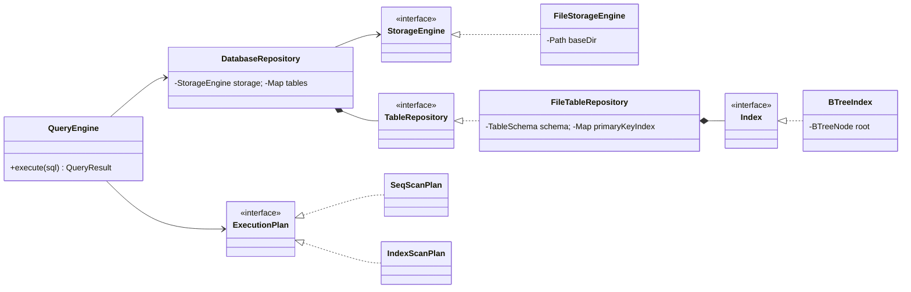
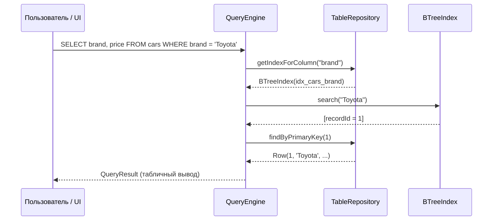

# Simple DBMS (Java)

Упрощённая реляционная СУБД на Java 17 с дисковым хранилищем (JSON), B-Tree индексами, разбором SQL, консольным CLI и графическим интерфейсом на Swing.

## 1. Функции и возможности

- **Типы данных**: `INT`, `DOUBLE`, `VARCHAR`, `DATE` (ISO-8601), `BOOLEAN`.
- **Ограничения и связи**: `PRIMARY KEY` (с контролем уникальности), `NOT NULL`, внешние ключи `REFERENCES` (каскадный запрет нарушения целостности при INSERT, UPDATE, DELETE, DROP).
- **Поддерживаемый SQL**:
  - DDL: `CREATE TABLE [IF NOT EXISTS]`, `DROP TABLE [IF EXISTS]`, `CREATE INDEX [IF NOT EXISTS]`, `DROP INDEX [IF EXISTS]` (включая table-level constraints `PRIMARY KEY (...)`, `FOREIGN KEY (...) REFERENCES ...`).
  - DML: `INSERT INTO` (одиночная и пакетная вставка), `SELECT` (с проекцией, фильтрацией, предикатами `AND`/`OR`, скобками, `IS [NOT] NULL`), `UPDATE`, `DELETE`.
  - Анализ: `EXPLAIN SELECT`, `SHOW TABLES`, `SHOW INDEXES`, `DESCRIBE <table>`.
- **Индексирование**: сбалансированное B-дерево (`BTreeIndex`), сохранение и загрузка с диска, оптимизация выборок (`IndexScan` $O(\log N)$ вместо `SeqScan` $O(N)$).
- **Надёжность**: атомарная запись файлов (`.tmp` + `ATOMIC_MOVE`), предзаписной журнал `wal.log` и автоматическая реконсиляция индексов после сбоя.
- **Интерфейсы**: интерактивный консольный CLI с табличным выводом и GUI на Swing.

## 2. Инструкция по запуску

### Сборка и запуск
```bash
# Сборка fat-JAR
mvn clean package

# Запуск модульных тестов
mvn test

# Интерактивная консоль CLI
java -jar target/simple-dbms-1.0.0.jar

# Графический интерфейс Swing
java -jar target/simple-dbms-1.0.0.jar --gui

# Запуск бенчмарка (B-Tree vs SeqScan)
java -jar target/simple-dbms-1.0.0.jar --benchmark

# Инициализация демонстрационных таблиц
java -jar target/simple-dbms-1.0.0.jar --init-demo
```

### Примеры команд
```sql
CREATE TABLE manufacturers (id INT PRIMARY KEY, name VARCHAR, country VARCHAR);
CREATE TABLE cars (id INT PRIMARY KEY, brand VARCHAR, price DOUBLE, is_available BOOLEAN, created_at DATE, manufacturer_id INT REFERENCES manufacturers(id));
CREATE INDEX idx_cars_brand ON cars (brand);

INSERT INTO manufacturers VALUES (1, 'Toyota Motor Corp', 'Japan');
INSERT INTO cars VALUES (1, 'Toyota', 25000.0, TRUE, '2024-01-15', 1);
INSERT INTO cars (id, brand) VALUES (2, 'BMW');

SELECT * FROM cars;
SELECT brand, price FROM cars WHERE price > 20000;
EXPLAIN SELECT * FROM cars WHERE brand = 'Toyota';
UPDATE cars SET price = 30000 WHERE id = 2;
DELETE FROM cars WHERE brand = 'Toyota';
```

## 3. Архитектура системы

- **Паттерны проектирования**:
  - *Repository*: `DatabaseRepository`, `TableRepository`, `FileTableRepository`.
  - *DAO / Storage Engine*: `StorageEngine`, `FileStorageEngine`.
  - *Iterator*: `RowIterator` для последовательного сканирования строк.
  - *Plan / Strategy*: `ExecutionPlan`, `SeqScanPlan`, `IndexScanPlan`.

### Диаграмма классов


### Диаграмма последовательности (Оптимизация SELECT индексом)


## 4. Результаты тестирования производительности

Замер производительности (`BenchmarkRunner`, `java -jar target/simple-dbms-1.0.0.jar --benchmark`):

| Записей (N) | SeqScan (ms) | IndexScan (ms) | Ускорение |
|-------------|--------------|----------------|-----------|
| 500         | 0.1471       | 0.0385         | 3.82x     |
| 2000        | 0.1398       | 0.0294         | 4.76x     |
| 5000        | 0.3081       | 0.0606         | 5.08x     |
| 10000       | 0.5055       | 0.0327         | 15.47x    |

`SeqScan` демонстрирует сложность $O(N)$, тогда как B-Tree поиск выполняется за $O(\log N)$, обеспечивая ускорение свыше 15x на 10 000 записей.

## 5. Область ответственности участников

- **Даниил Егоров**:
  - Архитектура хранения (`StorageEngine`, `FileStorageEngine`), сериализация таблиц и индексов в JSON, атомарная запись файлов (`.tmp`).
  - Механизм предзаписного журнала `wal.log`, контрольные точки `checkpoint()`, восстановление после сбоев.
  - Репозитории `TableRepository`, `FileTableRepository` (индекс PK, валидация ограничений) и фасад `DatabaseRepository`.
  - Модели предметной области (`Column`, `DataType`, `ForeignKey`, `Row`, `TableSchema`) и настройка сборки Maven.
- **Егор Глазов**:
  - Алгоритм индексирования (`Index`, `BTreeIndex`): сбалансированное B-дерево (расщепление узлов, заимствование, слияние, диапазонный поиск).
  - Синтаксический и лексический анализ SQL (`SqlLexer`, `SqlParser`): поддержка DDL, DML, выражений в скобках, приоритетов `AND`/`OR`.
  - AST узлы команд (`CreateTableStatement`, `InsertStatement`, `SelectStatement`, `UpdateStatement`, `DeleteStatement` и др.).
- **Максим Жулин**:
  - Движок выполнения запросов `QueryEngine`, планировщик и планы `SeqScanPlan`, `IndexScanPlan`.
  - Пользовательские интерфейсы: консольный REPL `ConsoleApp`, форматирование `TablePrinter`, GUI на Swing `DatabaseGui`.
  - Тестирование и бенчмарк `BenchmarkRunner`, написание тестов JUnit 5.

## 6. Выводы

Реализована реляционная СУБД на Java 17, удовлетворяющая всем требованиям лабораторной работы: дисковое хранение связанных таблиц, 5 обязательных типов данных, SQL-парсер, сбалансированное B-дерево с персистентностью, ускоряющее выборки до 15.5x, CLI и GUI интерфейсы.

## 7. Список источников

1. Кормен Т., Лейзерсон Ч., Ривест Р., Штайн К. Алгоритмы: построение и анализ (4-е изд.). — М.: Вильямс, 2022. Глава 18 (B-деревья).
2. Гарсиа-Молина Г., Ульман Д., Уидом Д. Системы баз данных. Полный курс. — М.: Вильямс, 2003.
3. Документация Oracle Java Platform, Standard Edition 17 (`java.nio.file`, `java.time`, `javax.swing`).
4. Документация Jackson Databind (`https://github.com/FasterXML/jackson`).
